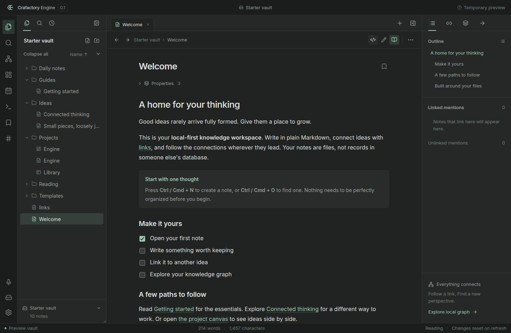

# Crafactory Engine

An independent, local-first Markdown knowledge workspace. Crafactory is a combination of Craft and Factory. Engine is the workspace for writing, linking, and arranging knowledge.

Original code is released under the MIT license. No Obsidian application code or branded assets are used. Functional interoperability is the long-term goal, but **version 0.2.0 is not a complete 1:1 replacement**. See [the parity ledger](docs/PARITY.md) before migrating an important vault.

中文交付范围、运行方式及未完成项见 [Crafactory Engine 交付说明](docs/Crafactory-Engine-交付说明.md)。该说明明确区分已有实现和完整复刻目标。



## Run

Unsigned Linux x64 AppImage and Debian packages are available in [the v0.2.0 prerelease](https://github.com/crafactory/engine/releases/tag/v0.2.0). Back up your vault before testing; consult the release notes for known gaps and verification boundaries.

Use Node.js 22.12 or newer and npm. A graphical session is required for the desktop app.

```sh
git clone https://github.com/crafactory/engine.git
cd engine
npm ci
npm run desktop
```

The desktop app opens the last vault, or a new folder named `Crafactory Vault` in Documents on first launch. Use the vault button to open any local folder. No existing notes are replaced just by opening a vault.

```sh
# Desktop development with hot reload
npm run desktop:dev

# Browser-only preview with temporary example data
npm run dev

# Build desktop packages on the current operating system
npm run dist -- --publish never

# Choose a vault on launch
npx electron . --vault /absolute/path/to/vault
```

The browser preview has no durable storage and is not the desktop product. It intentionally resets when reloaded. Native vault operations are available only through Electron's restricted preload bridge.

## Included workflows

- **Local vaults:** folders, plain Markdown, file watching, autosave, conflict detection, recoverable trash, previous-version snapshots.
- **Writing:** CodeMirror 6 source editing, live inline/block previews, editable table cells and task checkboxes, source reveal for selected blocks, reading view, undo/redo, selection formatting, find/replace, link/tag completion, slash insertions.
- **Markdown:** wikilinks, aliases, heading/block references, transclusion, images/audio/video attachments, task checkboxes, tables, footnotes, highlights, callout styling, KaTeX, Mermaid.
- **Connected thinking:** backlinks, unlinked mentions, outgoing links, outlines, nested tags, global/local force-directed graphs.
- **Navigation:** tabs, tab reorder, back/forward, quick switcher, command palette, bookmarks, one split pane, saved workspaces.
- **Visual organization:** `.canvas` text/file/link/group cards, resizing, dragging, connections, minimap, JSON source access.
- **Property views:** `.base` table/list/card views, property editing, sorting, safe basic expressions and filters, CSV export.
- **Utilities:** daily notes, templates, unique notes, random notes, note extraction/merge, recovery, slides, audio recording, limited web viewer.
- **Customization:** light/dark themes, locally bundled Inter font, CSS snippets, configurable hotkeys, core feature toggles, opt-in independent Worker plugins.
- **Portability:** Markdown and HTML exports, desktop PDF export, full vault ZIP export, Markdown/attachment import, a small local CLI.

Each of these has narrower boundaries than the mature reference application's corresponding feature. Details and unimplemented items are in [PARITY.md](docs/PARITY.md), not concealed behind placeholder buttons.

## Data layout

```text
My vault/
  Ideas/
    Thought.md
  Attachments/
  Board.canvas
  Library.base
  .crafactory/
    state.json
    recovery/
    trash/
    plugins/
```

Application metadata goes in `.crafactory`, not `.obsidian`. Opening a folder does not import `.obsidian` settings or execute its plugins. Renaming files in the GUI updates resolvable Markdown and wiki links in indexed text notes. CLI renames currently do not rewrite links.

Text writes are serialized and use a temporary file followed by rename. File fingerprints detect conflicting edits. Retained snapshots are previous saved versions, not keystroke-level backups; this does not replace an independent backup.

## Verify

```sh
npm run test
npm run build
npx playwright install chromium
npm run test:e2e
# Linux graphical CI
xvfb-run -a npm run test:desktop
```

The Verify workflow runs unit, browser, and desktop integration tests. The desktop build workflow produces unsigned build artifacts for Linux, Windows, and macOS; creating the workflow is not proof that all platforms have passed. Consult [verification notes](docs/VERIFICATION.md) for actually executed checks.

## Extensions

Copy `examples/plugins/word-tools` into `.crafactory/plugins/word-tools` in a vault. Open Settings → Community plugins and explicitly enable it. Plugins are disabled at every launch until opted in.

This is a deliberately small, new API. It is **not compatible with Obsidian's plugin API**. See [plugin development](docs/PLUGINS.md). Plugin commands receive note contents and may modify notes, so only enable code you trust.

## License and provenance

The application code, tests, documentation, and original geometric logo are MIT licensed. Lucide icons retain their ISC license, Inter retains its SIL OFL license, and libraries retain their respective licenses. See [THIRD_PARTY_NOTICES.md](THIRD_PARTY_NOTICES.md). Run `node scripts/notices.mjs` after dependency changes.

The implementation was written against public behavior documentation, not by decompiling or importing the proprietary app. This is an independent implementation, not a claim of formal clean-room separation or a legal clearance. The name and identity are Crafactory Engine, and the project is not affiliated with Obsidian.

Obsidian Sync and Publish are intentionally excluded. No hosted subscription replacement, telemetry, or account system is included.
