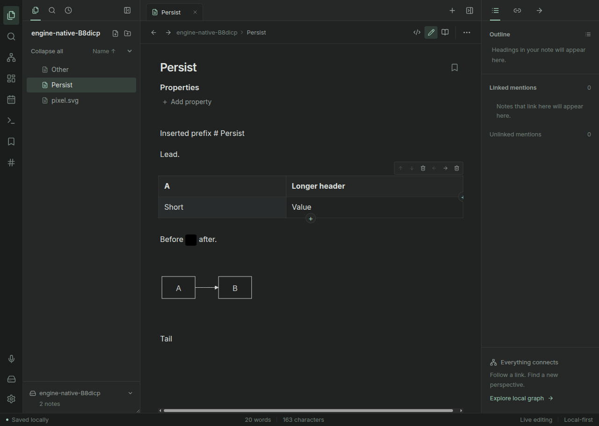

# Canvas and Live Edit regression inventory

Status: bounded candidate coverage executed below; latest-head review/CI and packaged publication remain separate gates. This change does not certify full Obsidian parity.

| Requirement | Functional acceptance | Visual state |
| --- | --- | --- |
| Canvas embed | Reading and Live modes render actual nodes and edges; opening the title opens the original Canvas; no editor controls or writes in an embed | Desktop dark/light, narrow screen; populated, empty and malformed Canvas |
| Canvas rename | Extensionless names preserve `.canvas`; explicitly changing file type is rejected; reopen retains Canvas JSON and embeds resolve the new name | Renamed Canvas and its host note |
| Long document with tables | Type before and after large tables; caret remains in the editor viewport; unchanged widgets retain DOM identity; undo/redo and source transitions remain usable | Scrolled bottom and table source |
| Live links | Wiki aliases and Markdown internal links navigate; safe external links work; selected source remains editable; code and unsafe schemes do not activate | Inactive and active link lines |
| Plugin status | Status takes reserved normal-flow space, never covers context footer | Populated status, right sidebar open, 1440px and 375px |
| Native plugin roadmap | Document kernel boundaries, editor provider replacement, lifecycle, trust and optional compatibility adapter | Documentation review, not runtime implementation |

Off-happy-path exploration: malformed Canvas; unsafe link scheme; rename to `.md`; edit another note referenced by an embed; unload plugin status with a long label. Baseline failures and post-fix results must be recorded separately.

## Live Editing stability follow-up

PR #75 adds original tests in `e2e/live-stability.spec.ts`, separate from the historical
counts below. The negative baseline reproduced a 186px column redistribution on opening
a short table cell and inline-image DOM replacement after typing above it. A second
negative test reproduced Mermaid SVG replacement on an external-note refresh while
the diagram source was unchanged. These are host bugs, not upstream-plugin findings.

The fixes freeze measured columns and edit-control height during a table edit; pass a
stable image context and rebind mapped source ownership without replacing decoded image
DOM; and exclude external-note snapshots from source/path-only block-contribution
identity. Embeds remain dependent on external notes. Changed diagram source still
invalidates its rendered result, and a replaced/unloaded contribution cannot reuse the
old component. Container resize while editing refreshes the measured grid without
committing the draft, and resize tracking ends with the edit. The tests cover 1440px and 390px tables, image identity/click ownership,
unchanged diagram geometry while typing, external transclusion refresh and actual
diagram-source invalidation. Full-suite, package and review gates are recorded in
`VERIFICATION.md`; this section is a regression inventory, not a full compatibility claim.

Strengthened rendered-label and real native-asset tests also found missing diagram labels,
root-relative inline-image paths refused by native guards, and stale decoded image bytes
after external modification. Mermaid now uses sanitized native SVG text rather than
HTML foreignObject labels. Root-path construction is corrected without relaxing the
native vault boundary. Per-asset size/mtime snapshots reload a changed inline image while
leaving unrelated decoded images intact; these are metadata-driven invalidations, not a
claim of content-digest monitoring or complete attachment/path parity.

All six new browser cases, both new native cases, the complete 70-case browser suite,
104-case Electron suite and 23-case actual Linux-package vault suite passed. The screenshot
below is from that packaged executable; identity, measurement and saved-byte assertions,
not the screenshot alone, establish the bounded stability claims.

## Historical executed candidate coverage

The full browser suite passed 48 tests, including twelve new cases. The unit suite passed 553 tests; the Linux desktop suite passed 45 cases with both fixed corpus modes enabled. Seven selected checks failed against the actual v0.5 merge in a detached worktree, then passed on the corrected candidate. A deeper bottom-cell commit check exposed a remaining viewport jump and was corrected using mapped scroll snapshots; it is not omitted from acceptance.

Interactive browser inspection covered actual Canvas geometry and links in dark/light desktop and 375px layouts, bottom-table commit visibility, resize-to-fit, and real compact local-graph activation. A staged status string was used only for illustrative browser geometry, not as evidence of a real community-plugin workflow; the native suite independently exercises a real plugin's status creation/unload.

The narrow Canvas is an overview with pan/zoom controls, not a claim that all node text remains readable at fit-to-screen scale. Invalid/empty sources and unsafe links have positive browser assertions. All installed-reference behavior, arbitrary grammar, complete Canvas file-card rendering, mobile native execution and large-Vault performance remain unverified.
